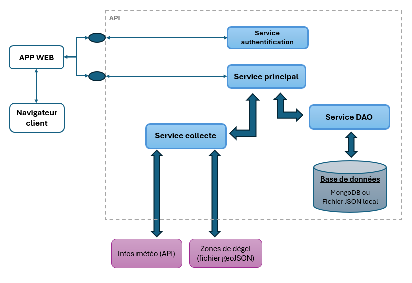

# Info-Sinistre-Auto

**Français** · [English](#english)

## Présentation

Info-Sinistre-Auto est un prototype d’intégration de données pour l’évaluation de réclamations automobiles. Les évaluateurs doivent souvent consulter plusieurs sources pour comprendre les circonstances d’un sinistre. L’application regroupe ces recherches en collectant des données météo et des informations sur les zones de dégel à partir de la date, de l’heure et des coordonnées de l’incident.

## Fonctionnalités

- Interface Web bilingue (français et anglais) pour rechercher un sinistre, collecter des données et associer des numéros de réclamation.
- API REST pour rechercher, créer et modifier les dossiers d’incident.
- Données météo historiques par heure et résumé des 24 heures précédant l’incident, via Open-Meteo.
- Identification de la zone et de la période de dégel à partir des données GeoJSON du gouvernement du Québec.
- Authentification par jeton JWT.
- Persistance dans MongoDB ou, par défaut, dans un fichier JSON local.
- Documentation Swagger pour les services d’authentification et de données.

## Technologies

Python, Flask, Flask-WTF, Flask-CORS, PyJWT, Flasgger/Swagger, Requests, Shapely, PyMongo, MongoDB et les API Open-Meteo et du gouvernement du Québec. L’interface Web utilise des modèles Jinja.

## Architecture simplifiée

L’application Web communique avec les services d’authentification et de données. Le service de données orchestre les appels au service de collecte et au DAO. Le service de collecte interroge les sources externes; le DAO lit et écrit les dossiers dans MongoDB ou dans le fichier JSON local.



## Démarrage local

Prérequis : Python 3.11 ou plus récent et un accès Internet pour la collecte météo et les données de zones de dégel. MongoDB est facultatif; sans connexion MongoDB, le DAO utilise `src/Service_DAO/db_incidents.json`.

Chaque composant possède son propre `requirements.txt` et doit être lancé dans un terminal séparé. Pour chacun des cinq composants ci-dessous, ouvrez un terminal à la racine du dépôt, puis exécutez les commandes de préparation en remplaçant `Service_Auth` par le dossier voulu :

```powershell
Set-Location src\Service_Auth
python -m venv .venv
.\.venv\Scripts\Activate.ps1
python -m pip install -r requirements.txt
```

Si PowerShell bloque l’activation de l’environnement virtuel, utilisez un terminal autorisant l’exécution du script ou appelez directement `.\.venv\Scripts\python.exe`.

Lancez ensuite chaque application dans son propre terminal :

| Composant | Dossier | Commande | Port local |
|---|---|---|---:|
| Authentification | `src/Service_Auth` | `python serv_auth.py` | 5602 |
| Collecte | `src/Service_Collecte` | `python serv_collecte.py` | 5020 |
| DAO | `src/Service_DAO` | `python serv_dao.py` | 5601 |
| Données | `src/Service_Data` | `python serv_data.py` | 5010 |
| Application Web | `src/web_app_info_sinistre` | `python web_app_main.py` | 5000 |

Le projet peut être déployé localement ou sur le cloud. En local, les services utilisent ces ports par défaut et la configuration référence `127.0.0.1`. Démarrez les services d’authentification, de collecte, de DAO et de données avant l’application Web. Ouvrez ensuite [http://127.0.0.1:5000](http://127.0.0.1:5000). Les documentations Swagger sont disponibles à [http://127.0.0.1:5010/apidocs](http://127.0.0.1:5010/apidocs) et [http://127.0.0.1:5602/apidocs](http://127.0.0.1:5602/apidocs).

Sur le cloud, définissez les variables d’environnement `SERV_AUTH_URL`, `SERV_COLLECTE_URL`, `SERV_DAO_URL` et `SERV_DATA_URL` avec les URL des services correspondants afin de configurer leurs communications. Pour utiliser MongoDB, connectez-le depuis l’interface Web avec une URI valide; sinon le stockage JSON local est utilisé.

## Limites connues

- Il s’agit d’un prototype : les identifiants de démonstration et certaines clés secrètes sont codés en dur. Ne pas exposer tel quel en production; configurer des secrets robustes et une authentification adaptée.
- Les données dépendent de la disponibilité et de la couverture des sources externes. La collecte des zones de dégel concerne le Québec; une coordonnée hors des zones connues retourne `N/A`.
- Le fichier JSON local est adapté au développement et à la démonstration, pas à l’accès concurrent ou à une persistance de production.
- La gestion des erreurs, la validation des entrées, les délais d’attente et les tests automatisés restent à renforcer, en particulier lors des appels aux API externes.
- Les services API démarrent en mode debug dans leur configuration locale; ce mode doit être désactivé pour tout déploiement réel.

---

<a id="english"></a>

## English

Info-Sinistre-Auto is a data-integration prototype for motor-claim assessment. Claims adjusters often need to consult several sources to understand the circumstances of an accident. This application brings those searches together by collecting weather and thaw-zone information from the incident’s date, time, and coordinates.

### Features

- Bilingual (French and English) web interface to search incidents, collect data, and associate claim numbers.
- REST API to search, create, and update incident records.
- Hourly historical weather and a summary of the 24 hours before the incident, using Open-Meteo.
- Thaw-zone and period lookup using GeoJSON data from the Government of Québec.
- JWT-based authentication.
- MongoDB persistence or, by default, a local JSON file.
- Swagger documentation for the authentication and data services.

### Technologies

Python, Flask, Flask-WTF, Flask-CORS, PyJWT, Flasgger/Swagger, Requests, Shapely, PyMongo, MongoDB, the Open-Meteo API, and Québec government data. The web interface uses Jinja templates.

### Simplified architecture

The web app communicates with the authentication and data services. The data service orchestrates calls to the collection service and DAO. The collection service queries external sources; the DAO reads and writes incident records to MongoDB or the local JSON file.


### Getting started locally

Prerequisites: Python 3.11 or later and Internet access for weather and thaw-zone data. MongoDB is optional; without a MongoDB connection, the DAO uses `src/Service_DAO/db_incidents.json`.

Each component has its own `requirements.txt` and must run in a separate terminal. For each of the five components below, open a terminal at the repository root and run the setup commands, replacing `Service_Auth` with the component’s folder:

```powershell
Set-Location src\Service_Auth
python -m venv .venv
.\.venv\Scripts\Activate.ps1
python -m pip install -r requirements.txt
```

If PowerShell prevents virtual-environment activation, use a terminal that allows script execution or call `.\.venv\Scripts\python.exe` directly.

Then start each application in its own terminal:

| Component | Folder | Command | Local port |
|---|---|---|---:|
| Authentication | `src/Service_Auth` | `python serv_auth.py` | 5602 |
| Collection | `src/Service_Collecte` | `python serv_collecte.py` | 5020 |
| DAO | `src/Service_DAO` | `python serv_dao.py` | 5601 |
| Data | `src/Service_Data` | `python serv_data.py` | 5010 |
| Web app | `src/web_app_info_sinistre` | `python web_app_main.py` | 5000 |

The project can be deployed locally or in the cloud. For local deployment, the services use these ports by default, and configuration points to `127.0.0.1`. Start authentication, collection, DAO, and data services before the web app. Then open [http://127.0.0.1:5000](http://127.0.0.1:5000). Swagger documentation is available at [http://127.0.0.1:5010/apidocs](http://127.0.0.1:5010/apidocs) and [http://127.0.0.1:5602/apidocs](http://127.0.0.1:5602/apidocs).

For cloud deployment, set the `SERV_AUTH_URL`, `SERV_COLLECTE_URL`, `SERV_DAO_URL`, and `SERV_DATA_URL` environment variables to the corresponding service URLs to configure inter-service communication. To use MongoDB, connect it from the web interface with a valid URI; otherwise, local JSON storage is used.

### Known limitations

- This is a prototype: demo credentials and some secret keys are hard-coded. Do not expose it as-is in production; configure strong secrets and suitable authentication.
- Data availability and coverage depend on external providers. Thaw-zone data covers Québec; coordinates outside known zones return `N/A`.
- Local JSON storage is intended for development and demonstration, not concurrent access or production persistence.
- Error handling, input validation, timeouts, and automated tests need improvement, particularly around external API calls.
- The API services start in debug mode in their local configuration; disable it before any real deployment.
